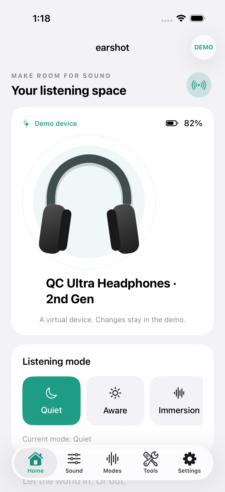
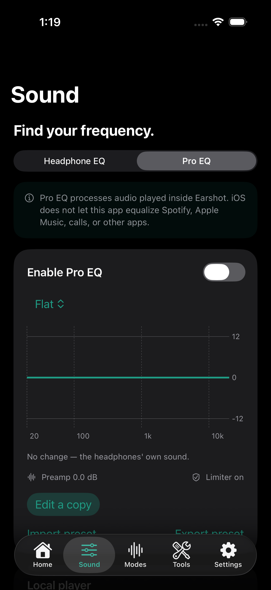
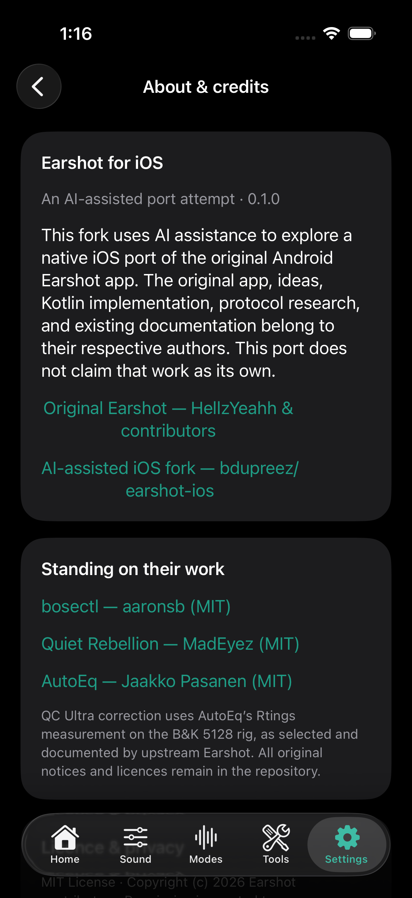

# Earshot for iOS — an AI-assisted port attempt

This is an **experimental, AI-assisted attempt to port the original [Earshot Android app](https://github.com/HellzYeahh/earshot) to native iOS**. The original app was created by **HellzYeahh and the Earshot contributors**. Their feature design, implementation, DSP, protocol research, tests, and documentation provide the foundation for this work. Full credit belongs to those authors; this fork does not claim to have invented Earshot.

Brian du Preez is using AI assistance/tokens to help explore an iOS port in [bdupreez/earshot-ios](https://github.com/bdupreez/earshot-ios). AI-generated code is experimental and needs review and real-device testing. This is not an official release of upstream Earshot, Bose, or Skullcandy.

The original [MIT licence](LICENSE), copyright notice, Android source tree, and research are preserved. Read [all credits and third-party notices](THIRD_PARTY_NOTICES.md). The original Android README is preserved in [docs/ANDROID_UPSTREAM_README.md](docs/ANDROID_UPSTREAM_README.md).

## Native iOS app

The primary development target of this fork is `ios/`: native **Swift + SwiftUI**, Core Bluetooth, AVFoundation, WidgetKit, App Intents, XCTest and XCUITest. No cross-platform wrapper, account, analytics SDK, or third-party Swift package is required.

Implemented areas include:

- Five native tabs: Home, Sound, Modes, Tools, and Settings, with light/dark appearance and iPhone/iPad layouts.
- Persistent, explicitly labelled demo profiles for the Bose models represented by upstream and the experimental Crusher interface. Demo data never establishes a physical Bluetooth connection.
- Real Bluetooth GATT discovery and Bose BLE L2CAP control transport, with a verified BMAP reply required before reporting connected. Battery, per-part earbud battery, noise control, modes, favourites, custom-mode layouts, device settings, and diagnostics use upstream BMAP knowledge. Physical headphone interoperability remains **unverified**.
- Native 3-band headphone EQ controls and a local-player Pro EQ: graphic/parametric filters, seven upstream presets including the AutoEq QC Ultra correction, response graph, headroom, preamp, limiter, and capped boost. JSON preset import/export and AutoEq text import are supported.
- Actual local audio playback through AVAudioEngine and a real microphone record/play/delete check using AVAudioRecorder. The microphone route is shown rather than assumed.
- Persistent on-connect/manual rules and schedules while the app is open, low-battery notification support, Quiet/Aware App Intents, and a WidgetKit overview linking back into the app.
- Original-project attribution in onboarding, About, diagnostics, and documentation.

This is **not complete Android feature parity**. [The migration matrix](docs/IOS_MIGRATION.md) records implemented, conditional, missing, and platform-restricted features. In particular, iOS does not offer a direct public replacement for Android's arbitrary RFCOMM sockets, Shizuku codec controls, global other-app EQ, call-volume boosting, or unrestricted app/background automation. Compatible BLE control services must be tested on physical headphones. Crusher's Bragi transport remains outstanding.

## Actual iOS simulator captures

These are native simulator captures of this AI-assisted port. Demo device values are simulated; they do not establish physical headphone compatibility. [More captures and provenance](docs/ios-screenshots/README.md).

<p align="center">
  
  
  
</p>

## Build with Xcode

1. Open `ios/Earshot.xcodeproj` in Xcode.
2. Select the shared **Earshot** scheme and an installed iPhone or iPad simulator.
3. Run. Choose **Try demo mode** to explore without physical headphones.

Development used the installed **Xcode 26.4.1 (17E202)** and **iOS 26.4** simulators. Deployment target is iOS 17.0+. No dependency manager is needed. A simulator build can run without signing:

```sh
xcodebuild -project ios/Earshot.xcodeproj -scheme Earshot \
  -destination 'platform=iOS Simulator,name=iPhone 17 Pro,OS=latest' \
  -derivedDataPath ios/build CODE_SIGNING_ALLOWED=NO build
```

For a physical iPhone, select your development team for both the app and Widget extension, use unique bundle identifiers if necessary, and provision the shared App Group `group.dev.earshot.ios` consistently with `EarshotShared` and the widget provider. Bluetooth/microphone permission descriptions are included. Headphone BLE transport, App Group provisioning, background behaviour, and real Bluetooth mic routing require hardware acceptance testing.

The checked-in project is ready to open. If Swift files are added or removed, regenerate it with:

```sh
python3 ios/scripts/generate_project.py
```

## Simulator tests

The test targets run actual XCTest and XCUITest in the installed simulator; they do not merely inspect source. Tests cover BMAP frames and safety guards, parser/capability handling, DSP and real offline audio rendering, local player lifecycle, persistent model/rule state, onboarding, navigation, custom-mode persistence, presets/player UI, microphone recording/playback/deletion, attribution, and light/dark screenshots.

```sh
xcrun simctl list devices available
EARSHOT_SIMULATOR_ID=YOUR_SIMULATOR_UDID ios/scripts/test-simulator.sh
```

**Recorded acceptance:** 53 tests passed (41 unit + 12 UI), with zero failures or skips on the installed iPhone 17 Pro simulator. See the validation report below for secondary-device checks and remaining limits.

Results and screenshot attachments are stored in ignored `ios/TestResults/*.xcresult` bundles. Open a result bundle in Xcode to inspect individual assertions, logs, and screenshots. See [the validation report](docs/IOS_VALIDATION.md) for actual outcomes, environment, and limitations. Simulator tests cannot validate a physical Bose Bluetooth connection, sound through headphones, hearing safety, or vendor firmware behaviour.

## Repository map and provenance

| Path | Purpose |
| --- | --- |
| `ios/Earshot/` | AI-assisted native Swift port: app, UI, models, Bluetooth/protocol, audio, platform tools |
| `ios/EarshotWidget/` | Native WidgetKit extension |
| `ios/EarshotTests/`, `ios/EarshotUITests/` | Native simulator tests |
| `app/`, `protocol/`, `dsp/`, Gradle files | Preserved original Android implementation by upstream contributors; reference for the port |
| `docs/IOS_MIGRATION.md` | iOS parity matrix, challenges, Apple API evidence, hardware acceptance plan |
| `docs/IOS_VALIDATION.md` | Recorded iOS build/test results and simulator screenshots |
| Other `docs/*.md`, `docs/screenshots/` | Historical upstream Android notes and screenshots, labelled as such |
| `docs/reference/` | Preserved third-party protocol/reference research, captures and licences; not original iOS work |

## Credits and licence

- **[Original Earshot — HellzYeahh and contributors](https://github.com/HellzYeahh/earshot)**: the Android app and foundation of this port (MIT).
- **[bosectl — aaronsb and contributors](https://github.com/aaronsb/bosectl)** and **[Quiet Rebellion — MadEyez and contributors](https://github.com/MadEyez/quietrebellion)**: Bose protocol and connection research (MIT), as credited by upstream.
- **[AutoEq — Jaakko Pasanen and contributors](https://github.com/jaakkopasanen/AutoEq)**: headphone correction data (MIT); the QC Ultra curve selected by upstream uses Rtings/B&K 5128 measurements.

See [THIRD_PARTY_NOTICES.md](THIRD_PARTY_NOTICES.md) and [LICENSE](LICENSE). Preserve those notices when redistributing. Bose, QuietComfort, Skullcandy, Apple, and other product names remain their owners' trademarks. No affiliation or endorsement is implied.
